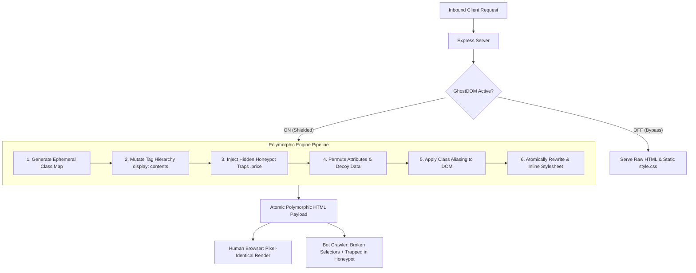

# 👻 GhostDOM — Server-Side DOM Polymorphism & Honeypot Bot Defense

> **Live Event Prototype & Presentation Kit**  
> An adversarial server-side middleware for Node.js/Express that mutates a website's HTML/CSS structural topology on **every single HTTP transaction**. The rendered page appears visually identical and pixel-perfect to human users, while completely breaking automated scrapers relying on fixed CSS/XPath selectors.

---

## ⚡ The Core Problem GhostDOM Solves

Traditional web scrapers (like `BeautifulSoup`, `Playwright`, `Puppeteer`, and `Scrapy`) harvest pricing, inventory, and proprietary data by anchoring to deterministic CSS selectors like:

```python
# The scraper's Achilles' heel:
prices = [el.text for el in soup.select(".product-card .price")]
```

Traditional defenses (CAPTCHAs, Cloudflare turnstiles, rate limits) degrade real user conversion rates, introduce latency, and are routinely bypassed by residential proxy networks and anti-detect browsers.

**GhostDOM takes an adversarial architectural approach:**
Instead of fighting the bot at the network edge, GhostDOM mutates the DOM tree itself. On every request, class names, tag hierarchies, and element attributes become transient polymorphic keys. Scrapers extracting `.price` receive **0 results** or are lured into **cryptographic honeypots** that flag their IPs in real time.

---

## 🧱 Architecture & Polymorphic Pipeline



### 5 Layers of Defense
1. **Class Name Randomization:** Maps every CSS class (e.g., `price` $\rightarrow$ `g_8f91a`) dynamically per request and atomically rewrites the stylesheet.
2. **Tag Hierarchy Mutation:** Injects random harmless `<div>` and `<span>` wrappers styled with `display: contents;`. Fixed CSS child combinators (`.product-card > .price`) and XPaths break, but CSS layout geometry remains 100% unaffected.
3. **Attribute Permutation:** Shuffles HTML attribute ordering and injects dynamic decoy `data-*` attributes (`data-item-hash`, `data-v-rendered`).
4. **Honeypot Trap Injection:** Seeds the DOM with hidden, off-screen decoy elements that **deliberately use the original unmutated selectors** (`.price`, `.product-card`) containing fake pricing (`$0.00`) and unique cryptographic trap URLs (`/honeypot/trap?token=...`).
5. **Real-Time Bot Quarantine:** Crawlers that scrape decoy prices or follow invisible links have their IP addresses immediately captured and added to the server-side blocklist.

---

## 📂 Project Directory Structure

```text
GHOST DOM/
├── package.json              # Node.js dependencies and scripts
├── requirements.txt          # Python dependencies (requests, beautifulsoup4)
├── server.js                 # Express server, route orchestration & dashboard APIs
├── README.md                 # Complete documentation & stage walkthrough script
├── data/
│   └── products.json         # 8 hardware products with rich metadata
├── middleware/
│   ├── ghostdom.js           # Response interceptor, bot logger & blocklist
│   └── mutator.js            # Pluggable DOM mutation engine (ML-ready)
├── public/
│   ├── css/
│   │   ├── style.css         # Target storefront styling (.product-card, .price, .stock)
│   │   └── dashboard.css     # Cyber-tech live defense deck styling
│   └── js/
│       └── dashboard.js      # Dashboard controller (live diff, test runner, stats)
├── views/
│   ├── index.html            # Apex Gear storefront template
│   └── dashboard.html        # Live presentation defense deck
└── scraper/
    └── scraper.py            # Naive Python scraper demonstrating bypass vs defense
```

---

## 🚀 Quickstart & Setup Commands

### 1. Prerequisites
- **Node.js**: v18+ (verified on Node.js v24)
- **Python**: 3.9+ (with `pip`)

### 2. Install Dependencies

In the root directory:

```bash
# Install Node.js dependencies
npm install

# Install Python scraper dependencies
pip install -r requirements.txt
# (On Windows, you can also run: py -m pip install -r requirements.txt)
```

### 3. Launch the Server

```bash
npm start
```

The console will indicate the active URLs:
- **Storefront**: [http://localhost:3000/](http://localhost:3000/)
- **Live Defense Dashboard**: [http://localhost:3000/dashboard](http://localhost:3000/dashboard)

---

## 🎤 2-Minute Live Event Demo Walkthrough (Stage Script)

Follow these exact steps when presenting GhostDOM live on stage:

### Act 1: The Status Quo (Scraping Vulnerability) — 30 Seconds
1. Open the **Dashboard** at `http://localhost:3000/dashboard`.
2. Flip the **GhostDOM Master Toggle** to **OFF (Bypassed)**.
3. Open a second browser tab to the **Storefront** at `http://localhost:3000/`. Show the audience the clean hardware catalog with 8 products. Right-click $\rightarrow$ **Inspect** to highlight the obvious classes: `.product-card`, `.price`, `.stock`.
4. Return to the dashboard and click **"Run Scraper Test"** (or run `py scraper/scraper.py` in your terminal).
5. **Audience Takeaway:** The terminal prints **GREEN SUCCESS (8/8 products scraped)**:
   ```text
   [FOUND] Successfully extracted 8 products!
     ✓ Apex Pro Wireless Gaming Mouse  -> $129.99
     ✓ Nova ANC Spatial Headphones      -> $349.00
   [RESULT] SCRAPING SUCCESSFUL: Site is vulnerable to fixed CSS selectors.
   ```
   *Talking Point: "Any bot can scrape your pricing in under 50 milliseconds using standard selectors."*

---

### Act 2: Engage GhostDOM (Instant Polymorphism) — 45 Seconds
1. In the Dashboard header, click the **Master Toggle** to turn **GhostDOM ON (ACTIVE)**.
2. In the **Polymorphic Entropy Inspector**, click **"Fetch 2 Consecutive Requests"**.
3. **The Visual 'Mic Drop':**
   - Point to the side-by-side split view.
   - Show that Request 1 and Request 2 have completely different class hashes (`class="c_8f91a"` vs `class="g_2b40d"`), extra wrapper divs, and randomized data tags.
   - Point to the **Entropy Pill**: `100% POLYMORPHIC DIVERGENCE`.
   - Point to the **Mutation Overhead Card**: Show that this entire AST rewrite costs **under 2 milliseconds**!
4. Switch to the Storefront tab and refresh: Show that to a human eye, the website renders **100% pixel-identical**.

---

### Act 3: Trapping the Bot (The Honeypot Strike) — 45 Seconds
1. Return to the dashboard and click **"Run Scraper Test"** again (or run `py scraper/scraper.py` in terminal).
2. Watch the terminal output turn **RED**:
   ```text
   [PARSER] Querying DOM for price elements: soup.select(".price")
   [FAIL] Real product prices extracted: 0
   [HONEYPOT TRIGGERED] Scraped decoy price: $0.00
   [TRAP] Hidden honeypot link followed: /honeypot/trap?token=ghst_...
   [DEFENSE] IP quarantined and logged to GhostDOM Blocklist!
   ```
3. Scroll down to the **Detected Bot Activity Feed** in the dashboard:
   - The bot's IP address and timestamp have appeared in real time with status `BLOCKED`.
   - The Scraper Success Rate metric drops to `0.0%`.
4. *Closing Pitch: "Without degrading a single pixel of human user experience, GhostDOM turns every HTTP response into an adversarial labyrinth that breaks bots and traps scrapers."*

---

## 🤖 Machine Learning Extensibility (`mutator.js`)

`middleware/mutator.js` is intentionally architected with a decoupled Strategy Interface:

```javascript
/**
 * ML Extension Hook:
 * The heuristic generator can be swapped for an adversarial reinforcement learning
 * policy (e.g. Actor-Critic agent) that observes incoming scraper telemetry and
 * generates an optimal mutation policy vector:
 * 
 * Policy Output:
 * - targetSelectorPermutationVector
 * - tagInflationBudget (to minimize client memory)
 * - decoyEntropyCoefficient
 */
class GhostDomMutator { ... }
```

In an enterprise ML deployment, a lightweight ONNX model or reinforcement learning policy monitors scraper request headers, dynamically tuning the level of tag inflation and decoy entropy based on suspected bot traffic confidence scores.
